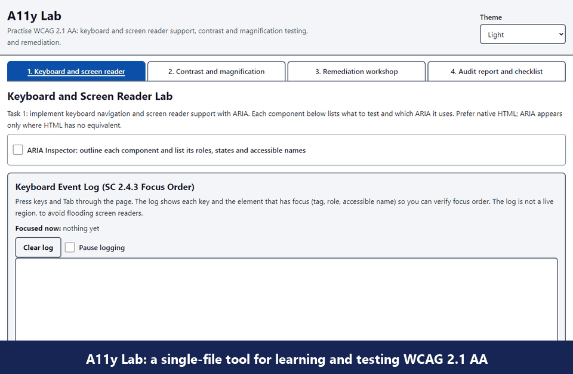

# A11y Lab

A single-file, framework-free teaching tool for **WCAG 2.1 AA**. Practise keyboard and screen reader support, test contrast and magnification, and fix a deliberately broken UI, all in one page.



**[Try it live](https://iaamhammad.github.io/a11y-lab/)**

## Getting started

Use the [live version](https://iaamhammad.github.io/a11y-lab/), or download or clone the repo and open `index.html` in any modern browser. There is no build step, no dependencies and no server needed.

```bash
git clone https://github.com/iaamhammad/a11y-lab.git
```

## Modules

| Module | What you can do |
| --- | --- |
| **1. Keyboard and screen reader** | Try APG patterns (tabs, accordion, modal dialog, menu button, sortable table), a validated form and status messages. The **key log** records every key press and focus change, and the **ARIA Inspector** shows each element's role, name and state. |
| **2. Contrast and magnification** | Check colour contrast against AA/AAA, get a suggested passing colour, scan the sample UIs, simulate colour blindness, and test zoom (SC 1.4.4), reflow (SC 1.4.10), text spacing (SC 1.4.12) and a lens magnifier. |
| **3. Remediation workshop** | Compare a "Before" UI containing **25 deliberate WCAG failures** with the fixed "After" version, side by side with diff highlights. Track found and fixed issues, with the success criterion, impact and code fix for each. |
| **4. Audit report and checklist** | Work through the WCAG 2.1 Level A and AA checklist, read the test-method guides, and generate an audit report to copy or print. |

The app also has **light, dark and high-contrast themes**, plus a skip link.

## Note

The Module 3 "Before" sample is **intentionally inaccessible**. Automated tools (axe, Lighthouse, WAVE) will flag it; that is the course material, not a bug.

The simulations (colour blindness, zoom, lens) are approximations. Also test with real assistive technology: NVDA, JAWS, VoiceOver, TalkBack, the OS magnifier and browser zoom.

## License

[MIT](LICENSE)
